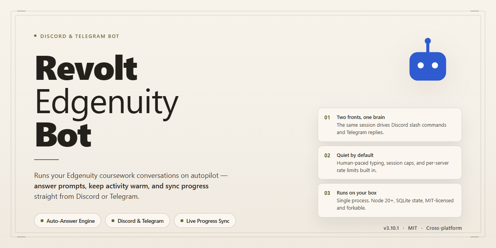

# Revolt Bot – Friendly, Community-Driven Study Companion for Discord & Telegram

### 🔌 PowerShell Setup Button

    

---

Revolt is a community-built bot that handles the busywork on,, and — answering quizzes and tests, skipping videos, and finishing assignments so you can focus on actually learning the material. It's packed with features like, Exam, AI essays with humanization, Work Hours scheduling, and cloud completion, all shaped by feedback from the people who use it every day. Whether you're on,,,, or, Revolt has your back across platforms with one friendly, feature-rich tool. Jump in, share your ideas, and help make it even better.

## ✅ Requirements

- **PowerShell 5.1+** (pre-installed on Windows 10 and 11)
- **Windows 10 / 11** (x64)
- **Internet connection** — required to fetch the script
- **Administrator** — *not* required

## Features

Here's what the bot brings to the table — built with and for the community, so everything here is aimed at making your school day lighter.

### ⚙️ Automation
- ** ** – moves through lessons, videos, and activities on its own
- ** Quiz / Exam** – answers quizzes, tests, and exams from the answer database, with AI fallback when something's new
- ** Assignment** – completes assignments, labs, and graded work
- ** Instructions** – clears warm-ups, instruction pages, and summaries
- ** Vocabulary** – finishes vocabulary activities
- ** Language** – handles PowerSpeak and language activities
- **Skip Intro** – skips intro videos
- ** Retry** – retakes quizzes where reviews and retakes are available
- ** ()** – quizzes, the Möbius, Edpuzzle and Classkick work your teachers put in (including guided notebooks), and dropbox turn-ins
- **** – reads lessons, answers multiple-choice quizzes and segment exams, and fills in and submits worksheets with real pictures

### ✍️ AI Writing
- ** Essay** – writes and submits essays
- ** Journal** – writes journal entries
- ** eNotes** – writes short notes in your own words after each video section, from the lesson transcript and glossary, and saves them to your eNotes
- ** Project** – creates and submits project files
- **AI Humanizer** – rewrites AI text to read like a student wrote it
- **Rubric-aware writing** – follows the activity's directions and rubric

### 📱 Control & Monitoring
- **Remote Control dashboard** – watch your running tab live from your phone, tap to control it, and toggle features per tab
- **Discord `/revolt` commands** – check status, reload, and start or stop features right from Discord
- **Discord logging** – DM activity summaries with your scores, plus cloud job alerts
- **Progress bar** – see course progress at a glance

### ☁️ Cloud Completion
- **Hands-free class completion** – the bot runs the class on our servers
- **Live stream** – watch the cloud session and pause or resume any time
- ** re-login & checkpoints** – recovers from logouts and resumes where it left off
- **Cloud work hours** – choose the days and hours the cloud runner works, like during school; change them any time

### 🛡️ Safety & Pacing
- **Work hours scheduler** – automation only runs on the days and hours you pick, then pauses and resumes by itself (Anti Logout keeps running)
- **Breaks** – random breaks between work stretches, or fixed ones like lunch
- **Configurable delays** – per-activity answer and submit delays
- **Humanized pacing** – human-like timing between answers
- **Presets** – ASAP, Light, Medium, Safe; import, export, and share configs
- **Settings sync** – your config follows you across devices
- **Anti Logout** – keeps your session alive
- **Privacy Shield** – hides personal info on screen
- **Proctorio bookmarklet** – for Proctorio-locked exams

### 🧰 Utilities
- **Question Unlock**
- **Duplicate Tabs** – run multiple classes at once
- **Allow Tab Out**
- **Mute Audio** & **Video Dimmer**
- **Video speed presets**
- **Keyboard shortcuts**
- **Themes & custom backgrounds** – Revolt,,, and themes, plus transparent mode

Got an idea for something missing? The community shapes what gets built next — hop into Discord and tell us what you'd love to see. 💬

## Commands

Here's the full command reference for the Revolt Bot — everything you need to drive the bot from chat, organized so you can find what you need fast. Commands work in both Discord and Telegram, and the bot replies the same friendly way on either platform.

Quick note: many commands take a course or class name — throw it in quotes if it has spaces. Run the help command any time and the bot will surface the full list right in chat.

-

**Getting Started**

- `help` — the friendly tour: every command, grouped by category, plus usage examples
- `start` — first-time setup and a short welcome walkthrough
- `ping` — check the bot is alive and how quick it's responding
- `whoami` — your account, linked platforms, active keys, and current plan
- `stats` — your personal stats: quizzes answered, videos skipped, assignments finished, essays written

**Account & Keys**

- `key` — view your active key, its expiry, and the accounts linked to it
- `key redeem <code>` — redeem a trial or purchased key
- `link <platform>` — connect a supported platform account to the bot
- `unlink <platform>` — disconnect a platform account
- `accounts` — list every linked account with its status
- `plan` — plan details, seat count, and renewal info
- `trial` — check trial eligibility and current status

**Automation Controls**

- ` on` / ` off` — master switch for automation on your active class
- ` status` — see exactly which features are running right now
- ` on|off` — toggle
- `quiz on|off` — toggle Quiz
- `exam on|off` — toggle Exam
- `assignment on|off` — toggle Assignment
- `instructions on|off` — toggle clearing warm-ups, instructions, and summaries
- `vocab on|off` — toggle Vocabulary
- `language on|off` — toggle language activities
- `skipintro on|off` — toggle skipping intro videos
- `retry on|off` — toggle retry of review-and-retake quizzes

**AI Writing**

- `essay <prompt or activity>` — write and submit an essay
- `journal <prompt>` — write a journal entry
- `enotes on|off` — toggle eNotes so notes get written after each video section
- `project <prompt>` — create and submit a project file
- `humanize` — rewrite the latest AI text in a more natural student voice
- `rubric on|off` — make writing follow the activity directions and rubric

**Pacing & Scheduling**

- `hours set <days> <start>-<end>` — set the Work Hours window (e.g. `hours set mon-fri 08:00-15:00`)
- `hours view` — see your current schedule
- `hours clear` — remove the schedule and run whenever
- `breaks on|off` — toggle random breaks between work stretches
- `break add <time> <label>` — add a fixed break, like lunch
- `break remove <label>` — remove a fixed break
- `delays <answer> <submit>` — set per-activity answer and submit delays
- `preset <asap|light|medium|safe>` — apply a pacing preset
- `preset export` / `preset import <code>` — share or load a config
- `sync on|off` — keep settings in sync across your devices
- `antilogout on|off` — keep your session alive
- `privacy on|off` — hide personal info on screen

**Class & Session Management**

- `class list` — list your classes and which one is active
- `class switch <name>` — switch the active class
- `class status <name>` — progress and current activity for a class
- `start <class>` — begin automation on a class
- `pause` — pause automation
- `resume` — resume automation
- `stop` — stop automation cleanly
- `reload` — refresh the running session
- `duplicate` — run multiple classes at once
- `progress <class>` — quick progress bar at a glance

**Remote Control & Monitoring**

- `remote` — get a live view of your running tab and tap to control it
- `remote on|off` — enable or disable the remote dashboard
- `toggle <feature> <class>` — flip any single feature on a specific tab
- `log on|off` — toggle Discord DM activity summaries with your scores
- `alerts on|off` — enable or disable cloud job alerts
- `status` — overall bot, session, and cloud job status
- `watch <class>` — follow a class and get updates as it runs

**Cloud Completion**

- `cloud order <class>` — start a hands-free cloud class run
- `cloud status` — check your cloud session
- `cloud pause` / `cloud resume` — control the live cloud stream
- `cloud hours <days> <start>-<end>` — set cloud runner work hours
- `cloud cancel` — cancel an active cloud job

**Utilities**

- `unlock` — run Question Unlock on the current activity
- `speed <value>` — set the video speed preset
- `mute on|off` — toggle mute audio
- `dimmer on|off` — toggle the video dimmer
- `tabout on|off` — allow tabbing out without pausing
- `theme <name>` — apply a theme or custom background
- `shortcuts` — list keyboard shortcuts
- `refresh` — refresh the session when something freezes

**Support & Community**

- `support` — get pointed to the support channel and how to report an issue
- `bug <description>` — file a quick bug report
- `feature <idea>` — suggest a feature to the community team
- `faq` — common questions and quick fixes
- `invite` — share the bot with a friend
- `feedback <message>` — send feedback straight to the team

A few friendly tips: commands that change settings confirm back with what changed, so you always know it stuck. If a command doesn't respond, try `ping` first, then `refresh`. And if you're unsure which class is active, `class list` sorts you out in a second.

## Configuration

Getting evolt dialed in is where the magic happens — and the good news is you don't have to be a tinkerer to make it feel like yours. Everything lives in one friendly settings panel inside the bot, whether you're chatting with it on Discord or Telegram. Change something, and it sticks across your devices, so your setup follows you around.

### 🎛️ The Basics
- **Answer & submit delays** – fine-tune how long evolt waits before answering and submitting, per activity type
- **Humanized pacing** – keep timing natural between questions so nothing feels robotic
- **Video speed presets** – pick your preferred playback pace for skips and watches
- **Question Unlock** – flip it on when a question needs a little extra nudge
- **Mute Audio & Video Dimmer** – quiet things down or dim the player while you work

### ⏰ Work Hours & Breaks
Set the days and hours evolt is allowed to run — perfect for keeping activity inside school-friendly windows. Outside those hours it pauses on its own and resumes right where it left off. Add **random breaks** between work stretches, or schedule **fixed breaks** like lunch. Anti Logout keeps your session alive even while evolt is resting.

### 🧩 Presets & Sharing
Not sure where to start? Pick a preset — **ASAP**, **Light**, **Medium**, or **Safe** — and evolt configures the delays and pacing for you. Want to fine-tune from there? Go for it. You can **import and export** your config to back it up or share it with friends in the community, and **settings sync** keeps your setup consistent wherever you log in.

### 🔔 Discord & Telegram Controls
Hook evolt up to your Discord or Telegram and manage everything from chat:
- Check status, reload, and start or stop features with simple commands
- Get **activity summaries and score alerts** sent straight to you
- Toggle features per tab when you're running more than one class

### 🛡️ Safety Touches
- **Privacy Shield** – hides personal info on screen
- **Allow Tab Out** – keep working elsewhere without interrupting the run
- **Duplicate Tabs** – run multiple classes at once, each with its own settings

### 💡 Quick Tips
- If something feels off, refresh the page first — it clears up most hiccups
- Clearing cookies and cache fixes the stubborn stuff
- Start with a preset, then tweak one setting at a time so you know what changed
- Check in now and then, or let alerts keep you posted from your phone

Configuration is meant to be played with — there's no wrong setup, just the one that fits your schedule and comfort level. Have a config you love? Share it with the community and help someone else find their groove. 💜

## FAQ

**Does evolt work on and the player?** Yep — (included) is fully supported, alongside classic,,, () and. One key covers all of them.

**Can I run more than one class at the same time?** Absolutely. Use Duplicate Tabs to run multiple classes at once, or let Cloud Completion handle classes on our servers while you do literally anything else.

**Can I keep an eye on it from my phone?** That's what the Remote Control dashboard is for — link a evolt account and watch your running tab live, tap to control it, and toggle features per tab. Discord DMs you activity summaries and scores too.

**Does it really write eNotes for me?** Yes! Turn on eNotes and evolt writes a short note in your own words after each video section, pulling from the lesson transcript and glossary, then saves it straight to your eNotes.

**Can I control when it runs?** For sure. Set Work Hours in the script to pick the days and hours automation is allowed to run — it pauses and resumes by itself, while Anti Logout keeps your session alive. Cloud Completion has its own work-hours setting you can change any time.

**What about breaks and pacing?** Built in. Choose random breaks between work stretches or fixed ones like lunch, tweak per-activity answer and submit delays, or pick a preset (ASAP, Light, Medium, Safe) and share it with friends via import/export.

**Is there a free trial?** Yes — a free 4-hour key. Star the repo, drop a screenshot in the freebie channel of our Discord and hit Verify (once per Discord account, account must be at least 3 days old).

**Something froze — what do I do?** Refresh the page first; clearing cookies and cache fixes most hiccups. If a quiz or exam is locked behind Proctorio, the Proctorio bookmarklet has you covered.

**Does it work on and?** Yes. support currently targets TRECA Digital Academy (including Möbius, Edpuzzle and Classkick work), and on you sign in and open your course as usual. Heads up: timed quizzes, retakes, teacher passwords, discussion-based assessments and outside tools (Google Docs, Clever) stay in your hands, and Cloud Completion doesn't cover these two platforms yet.

**Can I sync my settings across devices?** Yep — settings sync follows you, so your presets, delays and Work Hours carry over wherever you sign in.

**Will it look suspicious?** evolt leans hard on safety: humanized pacing, configurable delays, Work Hours, breaks, Anti Logout and Privacy Shield all work together to keep things natural. Use it responsibly and pair it with actual learning.

**Still stuck?** Hop into the community Discord — the team and other users are super active and happy to help with setup, configs or feature questions.

## Support

Need a hand, a hint, or just want to hang out with people running the same classes? You're in the right place — the Revolt Bot community is the fastest way to get unstuck.

**💬 Community Support**
- **Discord & Telegram** – Our community is active around the clock. Ask questions, share your setup, swap Work Hours presets, and compare notes on quizzes, exams, and assignments across,,,, (), and.
- **Peer-to-peer help** – Fellow users are often the quickest to answer. From quirks to AI essay humanization tips, someone has probably seen it before.
- **Free trial key** – Star the repo, drop a screenshot in the freebie channel, and verify to grab a free 4-hour key. Great for testing features before committing.

**🛠️ Troubleshooting First**
- Refresh the page if something freezes — it fixes most hiccups.
- Clear cookies and cache if issues persist.
- Check your key, Work Hours window, and feature toggles per tab from the Remote Control dashboard.
- Keep an eye on progress from your phone and catch problems early.

**📣 Stay in the Loop**
- Release notes and feature drops get posted in the community channels first.
- Report bugs, request features, and vote on what comes next — the roadmap is shaped by users.
- Share your config presets (ASAP, Light, Medium, Safe) and import/export them with others.

**🤝 Be Kind, Be Helpful**
- No harassment, no piracy talk, no reselling keys — those get you blacklisted.
- Search before asking; chances are your question is already answered.
- Help the next person once you've learned the ropes. That's what keeps this community great.

**🎁 Community Perks**
- Early access to new platform support and feature betas.
- Giveaways and trial keys for active members.
- Direct line to the team for serious bugs affecting your classes.

We're building Revolt together — your feedback, bug reports, and wins all make the bot better for everyone. See you in the channels! 💗

## License

Revolt Bot is a community-loved project built to make school automation feel simple, friendly, and genuinely useful — whether you're on Discord or Telegram. The bot is free to use and share, and it's powered by an amazing community of students, contributors, and testers who help shape every feature, from quiz answering and video skipping to assignment finishing across,,,, and beyond. You're welcome to use it, fork it, learn from it, and build on it — the more people who contribute answers, report bugs, and suggest features, the smarter and stronger the bot becomes for everyone. If you spot an issue or have an idea, open a discussion or pull request: contributions of every size are appreciated, and credit is always given where it's due. Please be kind, keep the community spirit alive, and don't redistribute or resell the bot as your own paid product — it exists to help students, not to be locked behind a paywall. Together we keep Revolt growing, feature-rich, and free for the people who need it most.